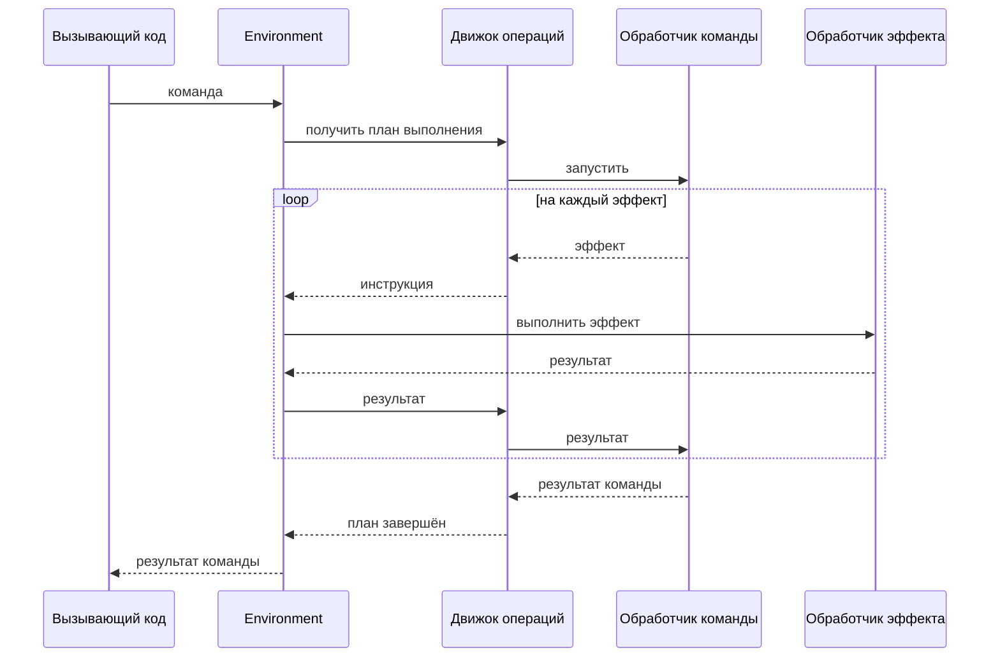

# 0001. Начальный концепт

- Статус: реализовано частично, см. «Что реализовано»
- Дата: 2026-11-21
- PR: #3
- Связано: README — весь документ

Запись описывает идею фреймворка и его ключевые сущности в том виде, в каком они были задуманы на момент PR #3. Последующие записи уточняют и пересматривают отдельные части.

## Назначение и мотивация

fidem — фреймворк для бизнес-логики. Цель — дать модель, в которой код надёжен, прозрачен, легко пишется, читается и тестируется, у проекта чёткая структура, а outbox, ретраи, идемпотентность, логи, метрики и подобное фреймворк даёт сам, без ручного кода в каждом обработчике.

Ключевая идея: бизнес-логика не выполняет побочные эффекты сама, а описывает их. Обработчик сообщения — генератор, который отдаёт описания действий и получает обратно их результаты. Исполняет действия фреймворк.

Отсюда фреймворк знает о приложении почти всё:

- **статически** — какие есть сообщения и обработчики, кто кого вызывает, какие события порождает команда, что обработчику разрешено делать, а что нет;
- **в рантайме** — каждое выполненное действие: какое сообщение, какие эффекты, в каком порядке, с каким результатом и за сколько.

На этом знании строятся возможности, которые в обычном приложении пишутся вручную или не делаются вовсе. Например:

- **Надёжность:** outbox, durable-выполнение с восстановлением после падения, ретраи.
- **Идемпотентность на входе:** повторная команда с тем же ID возвращает сохранённый результат.
- **Идемпотентность на выходе:** ID пишущего эффекта передаётся во внешнюю систему как ключ идемпотентности.
- **Согласованность через типы.** Проблема двойной записи (операция пишет в несколько систем, и эти записи нельзя согласовать) решается системой типов: atomic-обработчик может сделать только одну запись, а несколько записей согласуются через transactional outbox. Вообще типы обработчиков по возможности запрещают некорректные сочетания эффектов.
- **Наблюдаемость без ручной настройки:** логи с цепочкой причин, метрики и трассировка по сообщениям и эффектам.
- **Явный граф сообщений:** команда → события, которые она порождает → их события и т.д. Граф строится по типам, его можно посмотреть и проверить при старте приложения.
- **Дашборд** с полной картиной приложения: статическая структура и то, что происходит в рантайме.
- **Кеши:** фреймворк видит, какие эффекты выполняются, поэтому может сам ставить и инвалидировать кеши.
- **Тестирование:** бизнес-логика проверяется как поток эффектов, без моков и самописных заглушек.

Список не исчерпывающий: всё, что можно извлечь из знания о сообщениях и эффектах, — потенциальная возможность фреймворка.

## Эффекты

fidem построен на идее **системы эффектов**. Код не выполняет побочные действия напрямую, а описывает их значениями — эффектами — и передаёт исполнителю. Исполнитель решает, как выполнить эффект, и возвращает результат обратно в код. Так бизнес-логика отделена от того, как и где выполняются действия: одну и ту же логику можно выполнить по-разному — с журналом, ретраями, в транзакции, в тесте с подставленными результатами. Идея и термины взяты из языков и библиотек с системами эффектов: алгебраические эффекты в Koka и OCaml 5, библиотеки эффектов в Haskell, ZIO и Effect-TS.

**Эффект** — неизменяемое описание действия. У эффекта есть тип результата.

**Effectful-функция** — функция с эффектами, в противоположность чистой. В fidem это генераторная функция: она yield-ит эффекты, на каждый получает результат в той же точке кода и в конце может вернуть результат. Тип yield-имых эффектов — часть сигнатуры, поэтому то, что функции разрешено делать, видно и проверяется статически.

Эффекты делятся на категории. Категория определяет, кто исполняет эффект и какие гарантии к нему применимы:

| Категория | Что это | Исполняет |
|---|---|---|
| Внутренний | Действие внутри процесса без внешних побочных эффектов: кеш, конфиг, случайные числа | Environment |
| Внешний | Обращение к внешней системе: HTTP, брокер | Environment |
| БД | Работа с собственной БД сервиса | Environment |
| Управляющий | Управление потоком выполнения | Движок |

- **БД выделена отдельно от внешних систем**, потому что на собственной БД строятся outbox, транзакции и durable-режим.
- **Внешние эффекты и эффекты БД делятся на чтение и запись.** Чтение можно безопасно повторять. Запись меняет состояние, поэтому её обработчик обязан быть идемпотентен по ID эффекта: при ретрае и восстановлении запись повторяется с тем же ID. Внутренние эффекты на чтение и запись не делятся, потому что не меняют внешнее состояние.
- **Управляющие эффекты выполняет движок, а не Environment.** Они управляют потоком выполнения. Примеры: конкурентное выполнение нескольких эффектов, возврат зависимости из DI-фабрики сообщения.

**Обработчик эффекта** — функция, которая выполняет действие. На тип эффекта — ровно один обработчик, тип ищется точно, без учёта наследования: так однозначно, а польза наследования в реальных приложениях пока не ясна.

## Сообщения

**Сообщение** — вход в бизнес-логику. Сообщение — тоже эффект, поэтому обработчик вызывает другие команды, запросы и публикует события так же, как выполняет любой эффект.

| Тип | Назначение | Результат | Обработчиков на тип | Режим |
|---|---|---|---|---|
| Команда | Изменить состояние | есть | ровно один | ephemeral или durable |
| Запрос | Прочитать данные | есть | ровно один | только ephemeral: хранить прогресс чтения незачем |
| Событие | Зафиксировать факт | нет | сколько угодно, каждый — отдельная операция | ephemeral или durable |

**Объявление сообщения** связывает тип сообщения с обработчиком и режимом выполнения. В нём же стабильное имя для сериализации и хранения, не зависящее от имени класса, и (в планах) версия.

**События** доставляются через outbox: сохраняются в БД вместе с результатом операции и рассылаются обработчикам. Обработка события начинается только после успешного завершения породившей его операции.

**Расписание** публикует событие по cron. Расписание хранится в БД.

## Обработчики сообщений

**Обработчик сообщения** — effectful-функция: принимает сообщение, yield-ит эффекты и возвращает результат сообщения. Вид обработчика задаётся в объявлении и определяет, какие эффекты ему разрешены и как он выполняется.

**Контракт детерминизма.** Обработчик не делает ввода-вывода и не читает время, случайность и глобальное состояние напрямую — только через эффекты. При тех же входных данных и результатах эффектов он отдаёт ту же последовательность эффектов. На этом держатся ретраи, восстановление и воспроизводимость.

**Atomic.** Делает ровно одну запись, поэтому проблемы двойной записи у него нет. Выполняется в две фазы: в первой обработчик читает данные (внутренние эффекты, чтение внешних систем и БД), во второй возвращает одну запись. Запись — либо эффект записи во внешнюю систему, либо транзакция в БД сервиса. В транзакции можно сделать несколько записей в БД и опубликовать события: они пишутся в outbox той же транзакцией.

Несколько записей в разные системы согласуются по паттерну transactional outbox: операция пишет в свою БД и в той же транзакции публикует события, а записи во внешние системы делают обработчики этих событий. Если они тоже atomic, каждый из них так же делает одну запись: во внешнюю систему или транзакцию в БД со своими событиями.

Atomic выполняется только в ephemeral-режиме: запись одна, восстанавливать после падения нечего.

**Staged.** Может сделать больше одной записи: каждый эффект — отдельный шаг со своим результатом. Поэтому выполняется в ephemeral- или durable-режиме (см. «Режимы выполнения»).

**Обработчик запроса** отдаёт только эффекты чтения.

## Идентификаторы и детерминизм

- **ID сообщения** можно передать снаружи, иначе он генерируется случайно.
- **ID эффектов** детерминированно выводятся из ID сообщения и порядкового номера эффекта.
- **Всё, что порождает операция** (события, вложенные сообщения), тоже получает детерминированные ID, и так далее по цепочке.
- **ID корреляции и причины** связывают всю цепочку сообщений в логах и трассировке.

Зачем: повтор операции с тем же ID сообщения отдаёт эффекты с теми же ID. На этом строятся ретраи и восстановление без дублей, идемпотентность на выходе и воспроизводимость. Совпадают только ID, сами эффекты при повторе выполняются заново, — поэтому записи обязаны быть идемпотентны.

## Режимы выполнения

Режим задаётся в объявлении сообщения.

В обоих режимах при сбое операция ретраится. Режимы отличаются только тем, переживает ли прогресс выполнения падение процесса.

- **Ephemeral.** Состояние выполнения хранится только в оперативной памяти. При падении процесса прогресс теряется, и после перезапуска операцию нельзя продолжить с места прерывания.
- **Durable.** Прогресс выполнения хранится в БД: сообщение и каждый эффект с параметрами и результатом. После падения процесса операция восстанавливается: при старте Environment подхватывает незавершённые операции. Благодаря контракту детерминизма генератор обработчика проигрывается до точки падения на сохранённых результатах — уже выполненные эффекты заново не выполняются — и дальше продолжает выполнение как обычно.

Команды разных режимов можно вызывать друг из друга.

## Архитектура

**Минималистичное ядро.** В ядро входит только то, что нельзя реализовать вне его. Всё остальное — ретраи, идемпотентность, кеши и подобное — реализуется вне ядра, например мидлварями. Ядро поддерживает общие формы, а частные случаи сводятся к ним вне ядра: например, atomic возвращает транзакцию, а одна запись в БД или одно событие — её частные случаи. Так ядро не усложняется частными случаями.

Две части: чистый **движок операций** и внешний **Environment**.

Как выполняется команда:

**Движок операций** чистый, без ввода-вывода. Он превращает поток эффектов обработчика в поток инструкций и решает всё, что касается выполнения: режимы, транзакции, журнал, ретраи, публикацию событий, управляющие эффекты. Вся сложная логика сосредоточена здесь, потому что чистый код проще всего тщательно протестировать: проверяется поток инструкций, без моков ввода-вывода.

**Инструкция** — команда движка для Environment: вызвать обработчик эффекта, записать в журнал, начать или закоммитить транзакцию, записать в outbox.

**Environment** исполняет инструкции и возвращает результаты. Владеет обработчиками эффектов, БД, outbox-диспетчером и планировщиком. Своей логики выполнения не содержит, поэтому реализаций Environment может быть несколько: асинхронная, синхронная, для тестирования. Форму обработчиков эффектов определяет конкретная реализация.

## Мидлвари

Мидлвари оборачивают обработку сообщений и эффектов. Для сообщений это чистые effectful-функции, для эффектов — обычные функции. Классические примеры: ретраи, кеширование результата, идемпотентность на входе, логирование, метрики, таймауты.

## DI

- **Связывание.** Зависимости подставляются в обработчики автоматически по типу и имени параметра, без явных маркеров. Поэтому у обработчиков нет фиксированной сигнатуры.
- **Фабрики зависимостей.** Для эффектов — обычные функции или генераторы, если зависимость надо закрывать. Для сообщений — effectful-функции: зависимость возвращается через управляющий эффект, а состояние фабрики сохраняется, чтобы закрыть зависимость позже.
- **Скоупы зависимостей:** приложение, сообщение, эффект.

## Развилки

### Сначала ретраи, компенсации отложены

- Выбрано: при сбое staged-операция ретраится.
- Почему: проще, а детерминированные ID и идемпотентные записи делают повторы безопасными.
- Отложено: откат выполненных записей компенсациями, например отдельным видом обработчика. Решение о реализации пока не принято.

### Вид обработчика — в объявлении

- Выбрано: staged или atomic указывается явно в объявлении команды.
- Почему: обработчики разных видов — просто функции, по ним самим вид не определить, а явное объявление позволяет связать вид и тип обработчика.

## Что реализовано

В PR #3: эффекты и их категории, сообщения, staged-команды в ephemeral-режиме, детерминированные ID эффектов, движок с единственной инструкцией «вызвать обработчик эффекта», Environment с обработчиками эффектов. Остальное в этой записи — запланировано. Реализация мидлварей и сессий БД из прежней заготовки отложена.

## Открытое

- Семантика вложенных команд, особенно в staged.
- Политика ретраев atomic и staged.
- Правила сочетания режимов и видов обработчиков.
- Распределение работы в durable: один универсальный тип воркера или специализированные.
- Обработчик с компенсациями.
